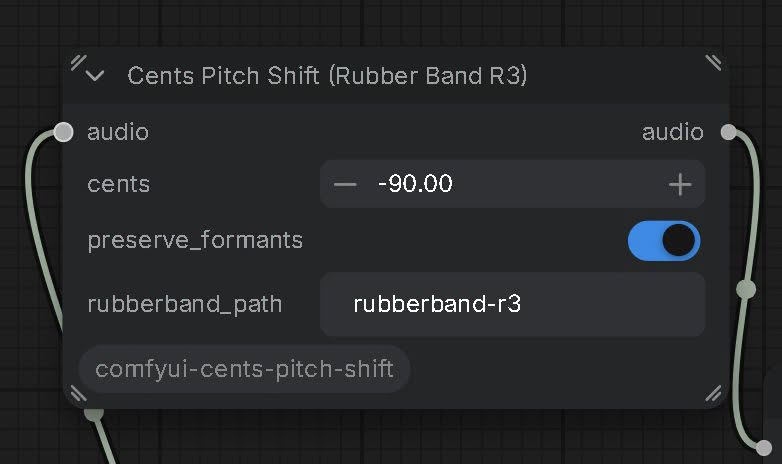

ComfyUI-Cents-Pitch-Shift
A ComfyUI custom node for precise audio pitch shifting in cents using Rubber Band’s high-quality R3 engine. Supports mono, stereo, and batched audio, optional formant preservation, and 0.01-cent control while retaining the original sample rate and length. Requires the (free) Rubber Band CLI found here: https://breakfastquay.com/rubberband/

Precise, duration-preserving audio pitch shifting for ComfyUI using Rubber Band’s high-quality R3 engine.

Adjust pitch in cents rather than whole semitones—useful for fine-tuning vocals, instruments, and generated audio.

Features

- Cents-based pitch control with 0.01-cent input increments.
- Pitch range from −2400 to +2400 cents: two octaves down or up.
- Explicit Rubber Band R3 processing.
- Optional formant preservation.
- Supports mono, stereo, and batched ComfyUI audio.
- Retains the original sample rate and sample count.
- Uses floating-point WAV intermediates.
- Zero-cent bypass returns the original audio without processing.
- Temporary audio files are automatically removed.

> The 0.01-cent increment describes the input control resolution, not a measured guarantee of pitch accuracy. Results depend on the source material and processing engine.

Requirements

- ComfyUI.
- Python dependencies listed in requirements.txt:
  - numpy
  - soundfile>=0.12.1
- Rubber Band command-line utility, version 3.0 or newer, with R3 support.

Rubber Band is a separate dependency and is not included with this node. Installing the Python requirements does not install the executable.

Installation

1. Install the custom node

Download this repository and place its folder inside:

text
ComfyUI/custom_nodes/comfyui-cents-pitch-shift/

The folder should contain:

text
comfyui-cents-pitch-shift/
├── __init__.py
├── requirements.txt
└── README.md

Avoid an extra nested folder between custom_nodes and the folder containing __init__.py.

2. Install Python dependencies

Use the same Python interpreter that runs your ComfyUI installation.

For a standard Python or virtual-environment installation, open a terminal in the node folder and run:

bash
python -m pip install -r requirements.txt

For Windows portable ComfyUI, run this from the portable installation’s root folder:

bat
python_embeded\python.exe -m pip install -r ComfyUI\custom_nodes\comfyui-cents-pitch-shift\requirements.txt

Adjust the paths if your installation uses a different layout.

3. Install Rubber Band

Download the command-line utility from:

[https://breakfastquay.com/rubberband/](https://breakfastquay.com/rubberband/)

Use version 3.0 or newer. The node explicitly requests the R3 engine.

Windows

Extract the Windows executable package to a permanent folder.

For example:

text
C:\AudioTools\RubberBand\

In the node’s rubberband_path field, enter the full path to the executable:

text
C:\AudioTools\RubberBand\rubberband-r3.exe

Do not put quotation marks around the path in the node field.

You can also use rubberband.exe: the node passes -3 to select R3 explicitly.

To check the executable, open Command Prompt and run:

bat
"C:\AudioTools\RubberBand\rubberband-r3.exe" --version

Alternatively, add the containing folder to your Windows PATH:

text
C:\AudioTools\RubberBand

Then set the node’s rubberband_path to:

text
rubberband-r3

PATH must contain the folder, not the full executable filename. Fully restart ComfyUI after changing PATH.

macOS

With Homebrew:

bash
brew install rubberband

Check the installed version:

bash
rubberband --version

Leave rubberband_path as rubberband if the executable is available to the ComfyUI process. Otherwise, enter its full path.

Linux

On Debian or Ubuntu:

bash
sudo apt install rubberband-cli

Check the version:

bash
rubberband --version

Some distribution repositories may provide older releases. Upgrade if the installed version does not support R3.

4. Restart ComfyUI

Search for:

text
Cents Pitch Shift (Rubber Band R3)

The node is registered under:

text
audio/effects

Usage

Connect the node between your audio source and your preview, processing, or save node:

text
Load Audio
    ↓
Cents Pitch Shift (Rubber Band R3)
    ↓
Preview Audio / Save Audio

Set the desired cents adjustment and queue the workflow.

Controls

| Input | Description | Default |
|---|---|---|
| audio | Standard ComfyUI AUDIO input. | Required |
| cents | Pitch adjustment. Positive raises pitch; negative lowers it. Range: −2400 to +2400. Input increment: 0.01 cent. | 0.0 |
| preserve_formants | Enables Rubber Band’s optional formant-preservation processing. | False |
| rubberband_path | Executable name on PATH or full path to the Rubber Band executable. | rubberband |

Cents examples

| Value | Requested adjustment |
|---:|---|
| 0 | Bypass processing |
| 7 | Raise pitch by 7 cents |
| -12 | Lower pitch by 12 cents |
| 50 | Raise pitch by half a semitone |
| 100 | Raise pitch by one semitone |
| -100 | Lower pitch by one semitone |
| 1200 | Raise pitch by one octave |
| -1200 | Lower pitch by one octave |

The node converts cents to fractional semitones internally:

python
semitones = cents / 100.0

This is a fixed pitch adjustment, not automatic pitch correction. It does not detect a key, identify notes, or snap vocals to a scale.

Output

The node returns standard ComfyUI AUDIO.

It preserves:

- Batch size.
- Channel count.
- Sample rate.
- Original sample count.
- Input waveform device and floating-point dtype on return.
- Other entries in the input audio dictionary.

If Rubber Band returns a slightly different sample count, the node trims the end or pads it with silence to match the original length. Matching the sample count does not guarantee sample-perfect transient alignment.

How It Works

For each item in the audio batch, the node:

1. Copies the waveform to CPU float32.
2. Writes a temporary floating-point WAV.
3. Runs Rubber Band with:
   - -3 to select R3.
   - -t 1.0 to request unchanged duration.
   - -p with the requested fractional-semitone adjustment.
   - Optional -F for formant preservation.
4. Reads the processed audio.
5. Checks the returned sample rate, channel count, and audio validity.
6. Matches the original sample count.
7. Returns the processed waveform.

Channels are passed to Rubber Band together rather than processed as separate mono files. Batch items are processed individually.

The node uses offline command-line processing. It does not require a VST host or a GPU.

Troubleshooting

The node does not appear

Check that:

- __init__.py is directly inside the custom node’s folder.
- The Python dependencies were installed into ComfyUI’s Python environment.
- ComfyUI was fully restarted.

Look in the ComfyUI startup console for an import traceback.

“Install Rubber Band CLI 3.0+…”

The node could not find the executable.

Set rubberband_path to its full path, for example:

text
C:\AudioTools\RubberBand\rubberband-r3.exe

Installing numpy and soundfile does not install Rubber Band.

“Cannot launch Rubber Band…”

Try running the executable directly from a terminal:

bat
"C:\AudioTools\RubberBand\rubberband-r3.exe" --version

Check that the path is correct and that the downloaded package was fully extracted.

“Rubber Band failed…”

Read the error details included in the ComfyUI traceback.

Confirm that the executable supports R3. The node deliberately requests R3 and does not silently fall back to R2.

The audio sounds unchanged

First check:

- cents is not 0, which intentionally bypasses processing.
- The preview or save node is connected to this node’s output.
- You queued the workflow after changing the value.

For diagnosis, temporarily set:

text
cents = 100

That requests a full semitone shift. Once processing is confirmed, return to your desired fine-tuning value.

Small cents adjustments may be subtle. If you still suspect an issue, compare saved input and output files rather than relying only on playback.

The output contains artifacts

Try a smaller pitch adjustment and compare formant preservation on and off.

No pitch-shifting algorithm is transparent on every source. Large shifts, dense mixes, transients, and some vocal material can produce audible artifacts.

The level changes

The node does not add a normalization stage. Rubber Band’s own processing and clipping protection may affect the output level.

Check the processed audio before final loudness adjustment or mastering.

Limitations

- Requires an external executable.
- Uses temporary files and offline processing; not intended for live monitoring.
- Batch items are processed sequentially.
- No built-in pitch detection, automatic tuning, or key correction.
- No guarantee of artifact-free processing or sample-perfect transient alignment.
- The full supported operating-system matrix has not been verified.
- Python syntax was checked during initial development; end-to-end behavior should be tested in your own ComfyUI environment.

Reporting Issues

When reporting a problem, include:

- Operating system.
- ComfyUI version or installation type.
- Rubber Band version.
- Full error traceback, if applicable.
- Node settings.
- Audio sample rate and channel count.
- Whether the issue also happens with a 100-cent adjustment.
- A minimal example workflow and short audio sample, if you can share them.

Remove personal file paths or private audio before posting publicly.

Credits

Vibecoded by Corey Milner, Calgary Alberta, posted here into public domain, with no restrictions or limitations on usage.

Pitch shifting is performed by [Rubber Band](https://breakfastquay.com/rubberband/), developed by Breakfast Quay.

This project provides the ComfyUI wrapper and is not affiliated with or endorsed by Breakfast Quay.

Rubber Band is not bundled with this repository. Its license and any redistribution requirements apply separately.
